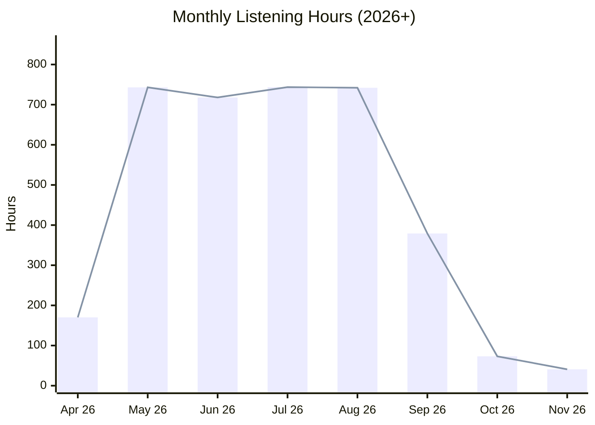
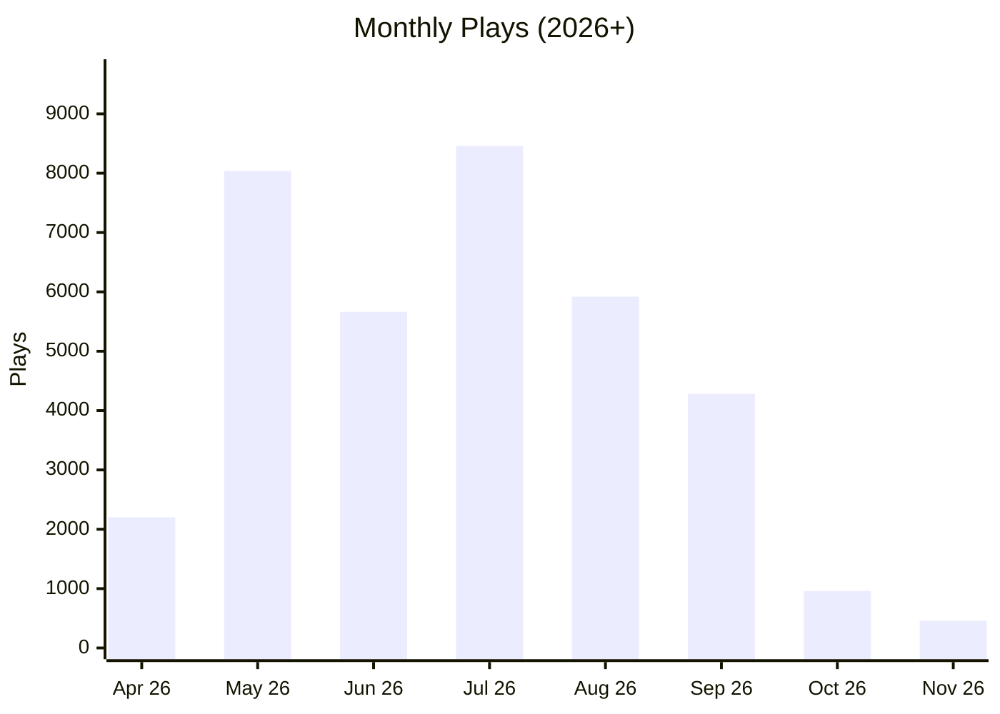

# 📝  output 

## ⚙️ [run #7118](https://github.com/jwenerd/ytm-dl/actions/runs/45924292723)

**Quick Links:** [📰 Listening Reports](reports/README.md) · [Milestones](MILESTONES.md) · [📁 Output Files](FILES.md)

### 🔥 Listening Activity (Last 24 Weeks)

**23,798 plays** · **151/165 active days** · Current streak: **11d** · Best streak: **100d**

| Day | 2026-06-15 → 2026-11-26 |
| :--- | :--- |
| Mon | 🟥🟥🟥🟥🟥🟥🟥🟥🟥🟥🟥🟥🟥🟨🟥🟥🟨🟧🟨🟧🟨⬛🟨🟨 |
| Tue | 🟥🟥🟥🟥🟥🟥🟥🟥🟧🟥🟥🟥🟥🟧🟥🟥🟨🟨🟧🟧🟨⬛🟧🟧 |
| Wed | 🟥🟥🟥🟥🟥🟥🟥🟥🟩🟥🟥🟥🟥🟥⬛🟩⬛🟨🟧⬛🟩⬛🟩🟥 |
| Thu | 🟥🟥🟥🟥🟥🟥🟥🟥🟨🟥🟥🟥🟥🟨🟥🟨🟥🟧🟨🟨🟨⬛🟨🟩 |
| Fri | 🟥🟥🟥🟥🟥🟥🟥🟥🟥🟥🟥🟥🟥🟧🟧🟨⬛🟨🟧🟧⬛⬛🟨▫️ |
| Sat | 🟥🟥🟥🟥🟥🟥🟥🟥🟥🟥🟥🟥🟥🟧🟨🟧🟩🟨🟥🟨⬛🟨🟨▫️ |
| Sun | 🟥🟥🟥🟥🟥🟥🟥🟥🟥🟥🟥🟥🟨🟨🟨🟨⬛🟨🟧🟨⬛⬛🟧▫️ |

*Legend: ⬛ 0 · 🟩 1–9 · 🟨 10–29 · 🟧 30–59 · 🟥 60+ · ▫️ upcoming*

### 📈 Monthly Trend (2026+)

Monthly Breakdown

| Month | Plays | Hours | Active Days |
| :--- | ---: | ---: | ---: |
| 2026-04 | 2,203 | 170.2h | 8 |
| 2026-05 | 8,039 | 743.1h | 31 |
| 2026-06 | 5,665 | 717.9h | 30 |
| 2026-07 | 8,460 | 743.7h | 31 |
| 2026-08 | 5,920 | 742.0h | 31 |
| 2026-09 | 4,282 | 379.1h | 29 |
| 2026-10 | 960 | 73.2h | 27 |
| 2026-11 | 459 | 40.8h | 17 |

